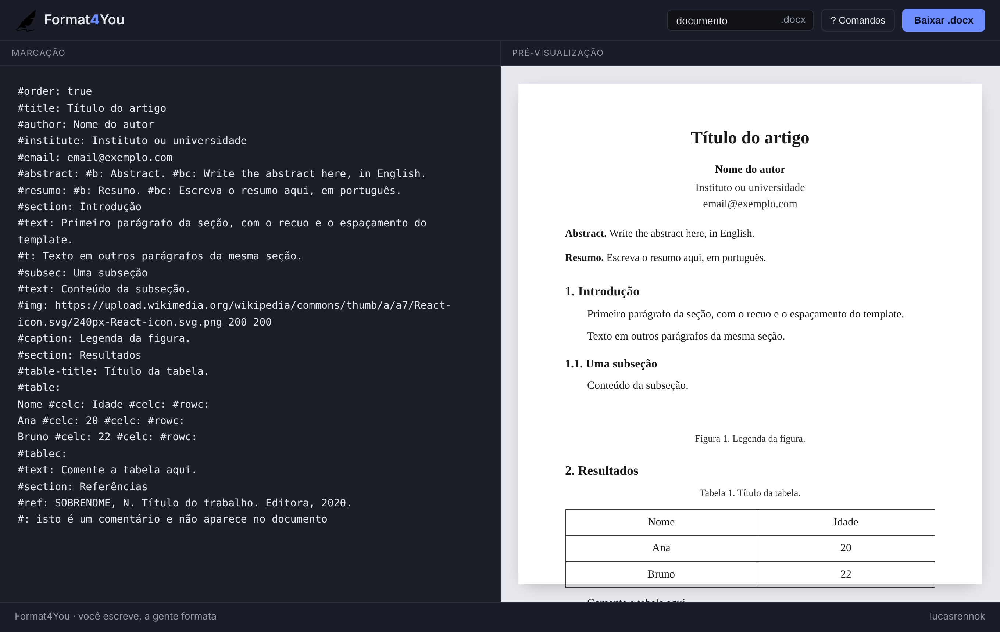

#  Format4You

> *Você escreve, a gente formata.*

Escreva um documento usando comandos simples de marcação e veja o resultado
tomando forma ao lado, em tempo real (estilo Overleaf). Quando terminar, baixe
em **.docx**.

Projeto antigo da faculdade, reescrito: a interface web foi migrada para
Vite + React, separada em componentes e ganhou uma pré-visualização ao vivo; o
backend de templates foi modernizado para TypeScript/ESM.



## :sparkles: Como é

- **Editor + pré-visualização** lado a lado
- **Marcação simples**: título, autor, resumo, seções, subseções, imagens,
  legendas, tabelas e referências
- **Numeração automática** de seções, figuras e tabelas (`#order: true`)
- **Exporta para .docx** usando a biblioteca [`docx`](https://docx.js.org/)
- Roda **inteiramente no navegador** — nada é enviado a servidor nenhum

## :open_file_folder: Estrutura

```
Format4You/
├── web/      front-end (React + Vite) — a aplicação em si
└── server/   back-end opcional (API de templates em Node + SQLite)
```

## :rocket: Rodando o front-end (`web/`)

É só isso que você precisa para usar o Format4You. Requer Node.js 20.19+.

```sh
cd web
npm install
npm run dev        # abre em http://localhost:3000
```

Para gerar a versão de produção (sai em `web/dist/`):

```sh
npm run build
```

O front-end já traz o template padrão embutido e **funciona sozinho, sem o
back-end**.

## :file_cabinet: Rodando o back-end (`server/`) — opcional

O servidor **não é necessário** para usar o Format4You. Ele existe para quem
quiser um sistema de **múltiplos templates** editável: guarda em SQLite os
estilos de cada template (comandos, estilos de texto e de parágrafo, margens) e
os expõe por uma API.

```sh
cd server
npm install
cp .env.example .env     # Windows: copy .env.example .env
npm run db:setup         # cria as tabelas e popula o template SBC
npm run dev              # API em http://localhost:3333
```

> É uma **API**, não um site: a raiz `/` responde "rota não encontrada" de
> propósito. Para testar se está no ar, abra
> <http://localhost:3333/health> (deve mostrar `{"status":"ok"}`).

Detalhes das rotas e dos scripts em [`server/README.md`](server/README.md).

## :pencil: A marcação

Cada comando começa com `#` e termina em `:`. Exemplo:

```
#order: true
#title: Título do artigo
#author: Nome do autor
#abstract: #b: Abstract. #bc: texto do resumo
#section: Introdução
#text: Primeiro parágrafo da seção.
#img: https://exemplo.com/figura.png 200 200
#caption: Legenda da figura.
#table:
Nome #celc: Idade #celc: #rowc:
Ana #celc: 20 #celc: #rowc:
#tablec:
#ref: SOBRENOME, N. Título. Editora, 2020.
#: isto é um comentário
```

- `#b:` / `#bc:` ligam e desligam **negrito**; `#i:` / `#ic:` o *itálico*.
- A lista completa de comandos fica no botão **"? Comandos"** dentro do editor.
